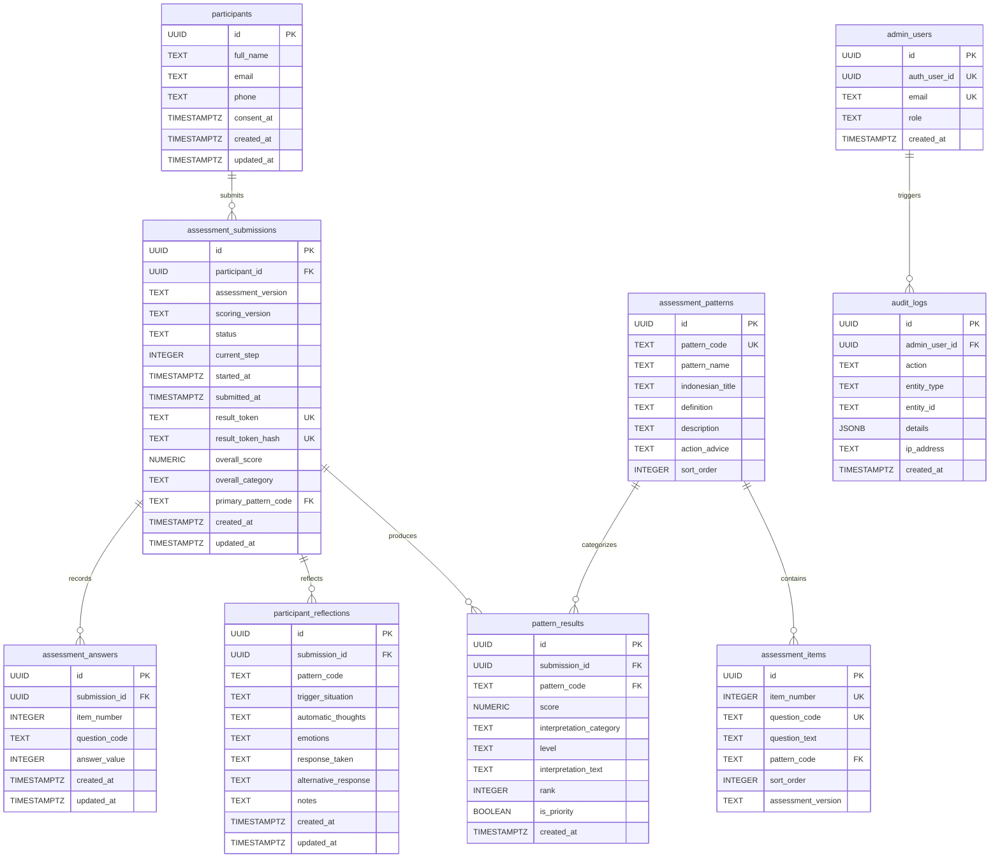

# DATABASE SCHEMA & MIGRATION SPECIFICATION
## Personal Soul Blueprint™ — The Soul of Speaking Indonesia

Dokumen ini mendokumentasikan skema database relasional PostgreSQL (Supabase), relasi antar entitas, indeks performa, dan kebijakan Row Level Security (RLS).

---

## 1. Diagram Relasi Entitas (ERD)

---

## 2. Definisi Tabel

### 2.1. `participants`
Menyimpan data identitas peserta yang mengikuti asesmen tanpa memerlukan pembuatan akun atau kata sandi.
- `id` (UUID, Primary Key, Default: `uuid_generate_v4()`)
- `full_name` (TEXT, NOT NULL): Nama lengkap peserta.
- `email` (TEXT, NOT NULL, Index): Alamat email aktif.
- `phone` (TEXT, NOT NULL): Nomor telepon/WhatsApp.
- `consent_at` (TIMESTAMPTZ, NOT NULL): Waktu persetujuan pemrosesan data privasi.
- `created_at`, `updated_at` (TIMESTAMPTZ): Jejak waktu.

### 2.2. `assessment_patterns`
Katalog 9 pola komunikasi saat konflik sesuai metodologi The Soul of Speaking Indonesia.
- `pattern_code` (TEXT, Unique): Kode unik (`REACTIVE`, `ASSUMPTION`, `DEFENSIVE`, `AVOIDANCE`, `PEOPLE_PLEASING`, `CONTROL`, `JUDGMENT`, `LISTENING_GAP`, `ESCALATION`).
- `pattern_name` (TEXT): Nama resmi pola.
- `indonesian_title` (TEXT): Judul deskriptif bahasa Indonesia.
- `definition` (TEXT): Definisi metodologis baku.
- `description` (TEXT): Karakteristik perilaku.
- `action_advice` (TEXT): Rekomendasi latihan sadar.
- `sort_order` (INTEGER): Urutan tampilan 1-9.

### 2.3. `assessment_items`
27 butir pernyataan refleksi baku yang dipetakan tepat 3 pernyataan untuk setiap pola.
- `item_number` (INTEGER, Unique): Nomor butir (1-27).
- `question_code` (TEXT, Unique): Kode pernyataan (`Q01` - `Q27`).
- `question_text` (TEXT): Teks pernyataan asli berbahasa Indonesia.
- `pattern_code` (TEXT, Foreign Key): Referensi pola terkait.
- `sort_order` (INTEGER): Urutan penyajian.

### 2.4. `assessment_submissions`
Sesi asesmen peserta dari status pengisian hingga selesai dinilai.
- `id` (UUID, Primary Key)
- `participant_id` (UUID, Foreign Key)
- `status` (TEXT): `'in_progress'`, `'completed'`, `'abandoned'`.
- `current_step` (INTEGER): Langkah pertanyaan aktif (1-27).
- `result_token` (TEXT, Unique): Token akses acak untuk peserta.
- `result_token_hash` (TEXT, Unique, Index): SHA-256 hash dari token.
- `overall_score` (NUMERIC(4,2)): Nilai rata-rata dari 27 item (1.00 - 5.00).
- `overall_category` (TEXT): Label kategori deskriptif keseluruhan.
- `primary_pattern_code` (TEXT, Foreign Key): Pola prioritas urutan pertama.

### 2.5. `assessment_answers`
Penyimpanan jawaban per butir (1-5) dengan constraint unik per sesi dan nomor pertanyaan.
- `submission_id` (UUID, Foreign Key)
- `item_number` (INTEGER, 1-27)
- `answer_value` (INTEGER, Range: 1 - 5)

### 2.6. `pattern_results`
Hasil kalkulasi skor masing-masing pola untuk setiap sesi pengisian.
- `submission_id` (UUID, Foreign Key)
- `pattern_code` (TEXT, Foreign Key)
- `score` (NUMERIC(4,2)): Nilai rata-rata 3 item pola.
- `interpretation_category` (TEXT): Rentang kategori deskriptif.
- `level` (TEXT): `'RENDAH'`, `'SEDANG'`, atau `'TINGGI'`.
- `rank` (INTEGER): Peringkat pola (1-9).
- `is_priority` (BOOLEAN): Status apakah termasuk prioritas refleksi utama.

### 2.7. `participant_reflections`
Catatan refleksi terstruktur pasca-asesmen (pemicu, pikiran, emosi, respons alternatif).

---

## 3. Kebijakan Row Level Security (RLS)

- **assessment_patterns & assessment_items:** Publik dapat membaca (`SELECT USING (true)`). Modifikasi dibatasi hanya untuk Superadmin.
- **participants & assessment_submissions:** Partisipan hanya dapat mengakses data miliknya melalui endpoint server yang memverifikasi token hash secara terisolasi. Partisipan tidak dapat melakukan query langsung untuk melihat partisipan lain.
- **Admin Access:** Hak akses penuh diberikan hanya jika `auth.uid()` terdaftar pada tabel `admin_users`.
